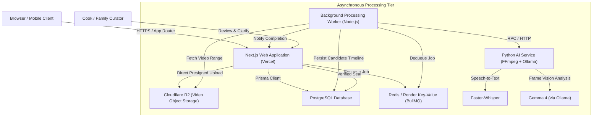
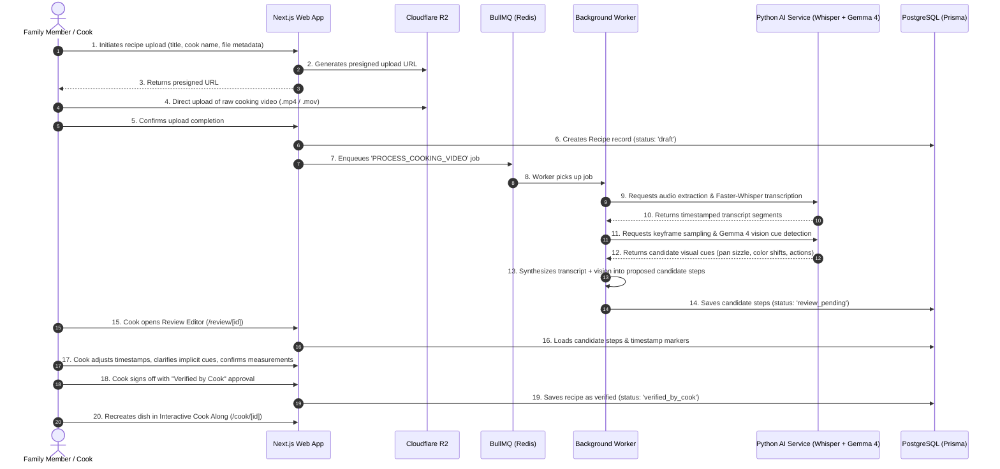
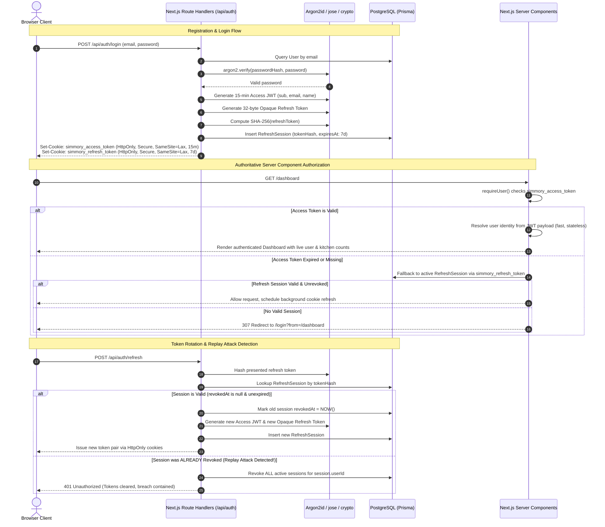
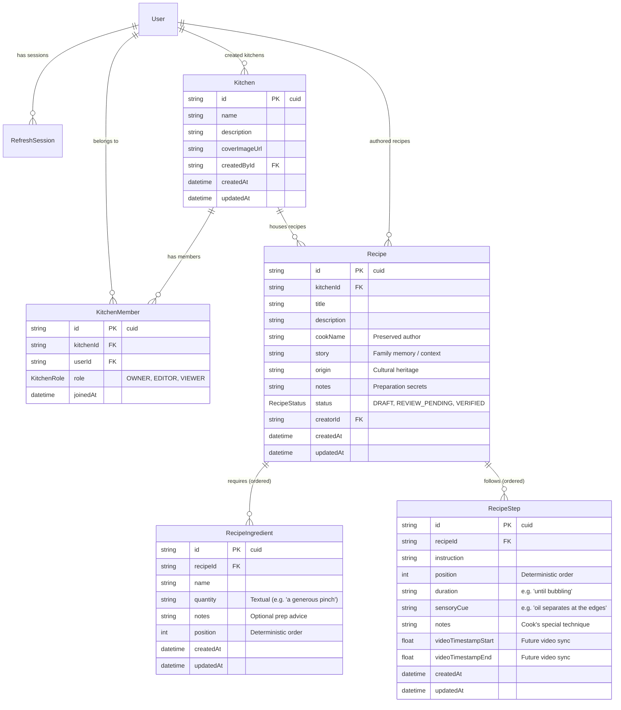
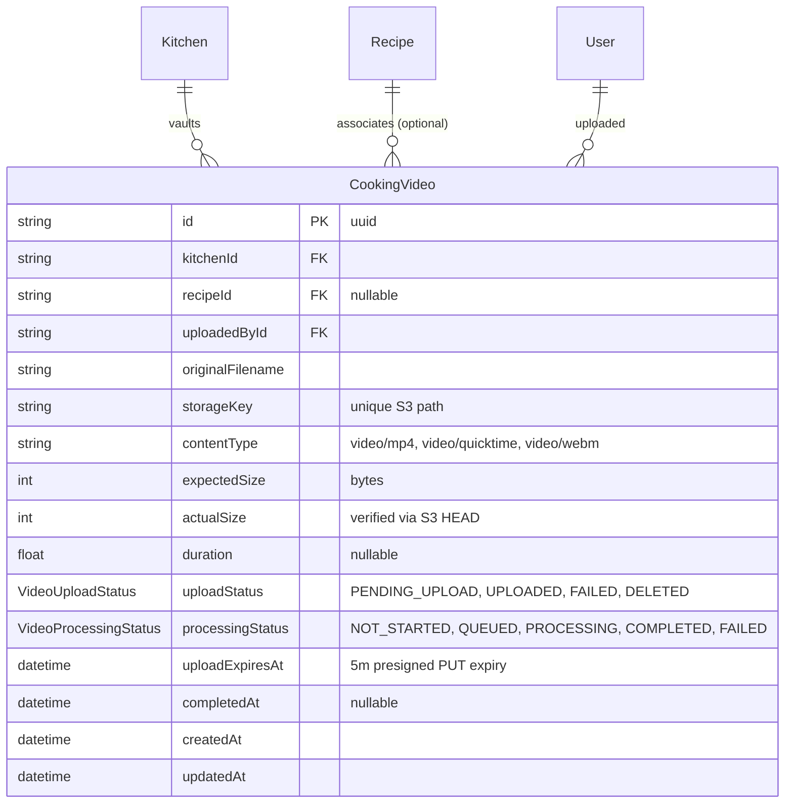

# Simmory — System Architecture & Technical Specifications

> **Product Philosophy:** *The way they made it, remembered.*  
> Simmory helps families capture, preserve, and reconstruct generational cooking knowledge without losing the original human experience.

---

## 1. Application Structure & Directory Organization

The frontend and initial web layer is architected as a Next.js App Router application in TypeScript with React 19, strict type safety, and Tailwind CSS. The codebase is organized by functional concern to maintain clean boundaries between server orchestration, presentation, and domain models.

```
simmory-web/
├── docs/
│   ├── architecture.md               # System architecture and technical specifications
│   └── cloudflare-r2.md              # Cloudflare R2 setup, CORS, security, and troubleshooting
├── prisma/
│   ├── migrations/                   # PostgreSQL schema migrations (Phase 2, 3 & 4)
│   └── schema.prisma                 # Prisma schema (User, RefreshSession, Kitchen, Recipe, CookingVideo)
├── prisma.config.ts                  # Prisma 7 configuration (migrations & environment)
├── public/                           # Static assets, branding, and icons
├── src/
│   ├── app/                          # Next.js App Router (Server Components by default)
│   │   ├── api/
│   │   │   ├── account/              # Profile and password update Route Handlers
│   │   │   ├── auth/                 # register, login, refresh, logout, me Route Handlers
│   │   │   ├── kitchens/             # list, create, detail, update, delete, members
│   │   │   ├── recipes/              # list, create, detail, update, delete
│   │   │   ├── storage/status/       # storage configuration and limit inspection
│   │   │   └── videos/               # initiate, complete, playback, list, detail, delete
│   │   │       ├── [id]/
│   │   │       │   ├── complete/route.ts
│   │   │       │   ├── playback/route.ts
│   │   │       │   └── route.ts
│   │   │       ├── initiate/route.ts
│   │   │       └── route.ts
│   │   ├── cook/
│   │   │   └── [id]/page.tsx         # Interactive Cook Along experience (video-linked)
│   │   ├── dashboard/
│   │   │   └── page.tsx              # Protected kitchen overview, activity, and stats
│   │   ├── kitchens/
│   │   │   ├── [id]/page.tsx         # Family Kitchen archive detail & recipe collection
│   │   │   └── page.tsx              # Protected Family Kitchen collections listing
│   │   ├── login/
│   │   │   └── page.tsx              # Editorial login page
│   │   ├── recipes/
│   │   │   ├── [id]/
│   │   │   │   ├── edit/page.tsx     # Recipe editor (ingredients, steps, sensory cues)
│   │   │   │   └── page.tsx          # Preserved recipe view (cues, story, ingredients)
│   │   │   ├── new/page.tsx          # Recipe creation page
│   │   │   └── page.tsx              # Protected recipe catalog with live search & filters
│   │   ├── register/
│   │   │   └── page.tsx              # Editorial registration page
│   │   ├── review/
│   │   │   └── [id]/page.tsx         # AI Recipe Review Editor
│   │   ├── settings/
│   │   │   └── page.tsx              # Protected account settings page
│   │   ├── upload/
│   │   │   └── page.tsx              # Protected direct R2 video upload entry point
│   │   ├── videos/
│   │   │   ├── [id]/page.tsx         # Video playback & metadata view (15m signed stream)
│   │   │   └── page.tsx              # Video library archive with filters & pagination
│   │   ├── globals.css               # Design system tokens & Tailwind v4 theme
│   │   ├── layout.tsx                # Root layout, Google fonts (Lora + Plus Jakarta), SEO
│   │   └── page.tsx                  # Public landing page
│   ├── components/
│   │   ├── account/                  # Settings form (profile & password)
│   │   ├── auth/                     # Login & Register editorial forms
│   │   ├── kitchens/                 # CreateKitchenDialog, KitchenSettingsDialog
│   │   ├── layout/                   # Application shells & layouts
│   │   ├── navigation/               # App header, authenticated sidebar, mobile drawer
│   │   ├── recipes/                  # RecipeForm, RecipeFilters, DeleteRecipeDialog
│   │   ├── ui/                       # Design system tokens, buttons, inputs, cards, badges
│   │   ├── upload/                   # UploadForm with real XMLHttpRequest progress
│   │   └── videos/                   # VideoCard, VideoFilters, VideoPlayer, DeleteVideoDialog
│   ├── generated/
│   │   └── prisma/                   # Generated Prisma Client
│   ├── lib/
│   │   ├── auth/                     # JWT, password, session, cookies, permissions (RBAC)
│   │   ├── services/                 # Kitchens, recipes, and videos domain service layer
│   │   ├── storage/                  # Cloudflare R2 / S3-compatible storage abstraction
│   │   ├── validations/              # Zod validation schemas (kitchen, recipe, video, auth)
│   │   ├── db.ts                     # Prisma Client singleton with pg.Pool adapter
│   │   ├── env.ts                    # Strict runtime environment validation
│   │   └── utils.ts                  # Pure utility functions
│   └── types/
│       └── index.ts                  # Core domain types
├── tests/
│   ├── integration/                  # Vitest PostgreSQL auth, kitchens, recipes & videos tests
│   └── unit/                         # Vitest unit tests (password, JWT, validation, storage)
├── package.json
├── tsconfig.json
└── vitest.config.ts
```

### Architectural Principles:
1. **Server Components by Default:** Pages and layout containers execute on the server. Interactive client hooks (`useState`, `usePathname`) are strictly confined to leaf client components (`"use client"`).
2. **Partial Prerendering (PPR) & Streaming:** Dynamic parameters and client navigation hooks are enclosed within React `<Suspense>` boundaries to guarantee rapid static HTML delivery with dynamic client hydration.
3. **Zero Fabrication:** The user interface never simulates fake progress bars, fake AI observations, or fabricated recipes. Empty and in-progress states remain honest and informative.

---

## 2. Planned Infrastructure & Service Topology

The production architecture separates interactive user-facing web requests from heavyweight asynchronous video and AI processing workloads.



### Component Roles:
- **Next.js Web Application (Vercel):** Serves Server Components, renders the design system, hosts Route Handlers (`/api/...`), and issues custom JWT authentication sessions.
- **PostgreSQL & Prisma ORM:** Relational database preserving user accounts, kitchen workspaces, cook profiles, confirmed recipe steps, sensory cues, and audit trails.
- **Cloudflare R2:** High-throughput, S3-compatible object storage for raw cooking video footage, optimized HLS streaming segments, and video thumbnails without egress fees.
- **BullMQ on Redis (Render Key Value):** Robust job queue managing asynchronous video ingestion, transcription, frame extraction, and timeline synthesis.
- **Python AI Service:** Dedicated microservice encapsulating the local Python proof-of-concept (FFmpeg audio extraction, Faster-Whisper, and Gemma 4 vision inference).

---

## 3. Separation Between Next.js and the Python AI Worker

To ensure Next.js remains responsive, low-latency, and serverless-friendly, all compute-heavy machine learning and media transformation operations are isolated into a standalone Python service.

| Concern | Next.js Web App | Python AI Service |
| :--- | :--- | :--- |
| **Primary Runtime** | Node.js / Vercel Edge / Serverless | Long-running container (Python 3.11+, GPU/CUDA optional) |
| **Responsibilities** | UI rendering, JWT auth, route security, recipe CRUD, cook review actions | Audio demuxing, Faster-Whisper transcription, frame sampling, Gemma 4 vision analysis |
| **Communication** | Enqueues jobs to Redis (BullMQ); polls/receives webhook updates | Reads job payload from queue / internal REST endpoint, writes progress events |
| **Failure Isolation** | Server crashes or video decoding timeouts in Python cannot impact web availability | Heavy GPU/CPU spikes do not degrade website response times |

---

## 4. End-to-End Cooking Video Processing Workflow



---

## 5. Security Boundaries & Data Isolation

### 1. Authentication & Session Security (Phase 2+)
- **Custom JWT Sessions via `jose`:** Stateless, cryptographically signed tokens stored in `HttpOnly`, `Secure`, `SameSite=Lax` cookies.
- **Strictly No Auth.js / NextAuth:** Minimal, audited custom session middleware verifying user claims and token expiration on protected Route Handlers.
- **No Secrets on Client:** API keys, database credentials, R2 secret keys, and JWT signing secrets remain accessible only to server runtimes via environment variables.

### 2. Media Upload & Access Control
- **Direct Presigned R2 Uploads:** Video files stream directly from the client browser to Cloudflare R2 via short-lived (15-minute) presigned URLs. Video payloads never pass through or saturate Next.js server memory.
- **Private Video Delivery:** Video playback in the Cook Along experience uses signed CDN tokens or authorized streaming proxies to guarantee unlisted family videos remain private.

### 3. Family Kitchen Boundary Isolation
- Every recipe and video belongs strictly to a `KitchenId`.
- Access control checks enforce that users can only view, review, or edit recipes belonging to kitchens where they have verified membership or creator ownership.

### 4. Human-in-the-Loop AI Boundary
- Raw AI transcripts and vision classifications are labeled internally as `is_candidate: true`.
- An AI observation is **never** presented to family members as confirmed instruction until a human user completes the review workflow.

---

## 6. Phase 2 Architecture: Database, JWT Authentication & User Management

Phase 2 replaces the static placeholder authentication and mock states with a production-grade PostgreSQL relational database layer, Prisma ORM, custom JWT authentication, Argon2id password hashing, opaque refresh-token rotation with replay detection, and server-side route authorization.

### 6.1 Database Schema (Prisma ORM & PostgreSQL)

The schema is defined in [`prisma/schema.prisma`](../prisma/schema.prisma) and managed through Prisma 7 using `@prisma/adapter-pg` with a pooled PostgreSQL client ([`src/lib/db.ts`](../src/lib/db.ts)).

```mermaid
erDiagram
    User ||--o{ RefreshSession : "has sessions"
    User ||--o{ KitchenMember : "belongs to"
    User ||--o{ Kitchen : "owns (created)"
    User ||--o{ Recipe : "creates"
    Kitchen ||--o{ KitchenMember : "has members"
    Kitchen ||--o{ Recipe : "contains"

    User {
        String id PK "cuid"
        String email UK "citext/lowercase unique"
        String passwordHash "Argon2id hash"
        String name "Full display name"
        String bio "Optional personal bio"
        String avatarUrl "Optional avatar URL"
        DateTime createdAt "Timestamp"
        DateTime updatedAt "Timestamp"
    }

    RefreshSession {
        String id PK "cuid"
        String userId FK "Cascade delete"
        String tokenHash UK "SHA-256 of opaque token"
        DateTime expiresAt "7-day expiration"
        DateTime createdAt "Timestamp"
        DateTime revokedAt "Null if active; set on rotation or revocation"
        String userAgent "Client device/browser string"
        String ipAddress "Client IP address"
    }

    Kitchen {
        String id PK "cuid"
        String name "Kitchen workspace name"
        String description "Optional kitchen description"
        String createdById FK "User reference"
        DateTime createdAt "Timestamp"
        DateTime updatedAt "Timestamp"
    }

    KitchenMember {
        String id PK "cuid"
        String kitchenId FK "Cascade delete"
        String userId FK "Cascade delete"
        String role "'owner', 'editor', 'viewer'"
        DateTime createdAt "Timestamp"
    }

    Recipe {
        String id PK "cuid"
        String title "Recipe name"
        String cookName "Original family cook name"
        String description "Story and context"
        String status "'draft', 'processing', 'review_pending', 'verified_by_cook'"
        String kitchenId FK "Cascade delete"
        String createdById FK "Cascade delete"
        DateTime createdAt "Timestamp"
        DateTime updatedAt "Timestamp"
    }
```



#### Key Schema Decisions & Indexes:
1. **Case-Insensitive Unique Emails:** `User.email` is normalized to lowercase in Zod validation schemas and constrained unique in PostgreSQL.
2. **Hashed Refresh Tokens:** Refresh tokens stored in `RefreshSession` are stored exclusively as 64-character SHA-256 hex digests (`tokenHash`). Even if the database is compromised, plaintext refresh tokens cannot be extracted.
3. **Foreign Key Cascades:** `onDelete: Cascade` is applied to all subordinate relations (`RefreshSession`, `KitchenMember`, `Recipe`) ensuring clean garbage collection without orphaned records.
4. **Strategic Indexes:**
   - `User(email)`
   - `RefreshSession(userId)`, `RefreshSession(tokenHash)`, `RefreshSession(expiresAt)`
   - `Kitchen(createdById)`
   - `KitchenMember(kitchenId)`, `KitchenMember(userId)`, `KitchenMember(kitchenId, userId)` (Unique compound index)
   - `Recipe(kitchenId)`, `Recipe(createdById)`, `Recipe(status)`

---

### 6.2 Authentication & Session Lifecycle

Simmory strictly rejects third-party managed auth providers (NextAuth/Auth.js, Clerk, Firebase, Supabase) in favor of a minimal, auditable, standard-compliant cryptographic authentication system built with `jose` and `@node-rs/argon2`.



#### Token Characteristics:
- **Access Token:**
  - Standard: JWT signed with HMAC-SHA256 (`HS256`) via `jose`
  - Lifetime: 15 minutes (`15m`)
  - Payload: `{ sub: string, email: string, name: string, iat: number, exp: number }`
  - Cookie: `simmory_access_token` (`HttpOnly`, `SameSite=Lax`, `Path=/`, `Secure` in production)
- **Refresh Token:**
  - Standard: 32-byte cryptographically secure random opaque token (64 hex characters)
  - Lifetime: 7 days (`7d`)
  - Storage: SHA-256 hash stored in `RefreshSession.tokenHash`
  - Cookie: `simmory_refresh_token` (`HttpOnly`, `SameSite=Lax`, `Path=/api/auth`, `Secure` in production)
- **Password Hashing:**
  - Algorithm: Argon2id via `@node-rs/argon2`
  - Parameters: Memory cost = 65,536 KiB (64 MiB), Time cost = 3 iterations, Parallelism = 4 threads.

---

### 6.3 Security Defenses & Hardening

1. **Replay Attack Detection:**
   When an access token expires, the client calls `/api/auth/refresh`. If an attacker attempts to reuse an older refresh token that was already rotated (`revokedAt !== null`), the system flags a session replay attack and **immediately revokes every active session for that user**, logging out all sessions and neutralizing the stolen credential.
2. **CSRF & Origin Verification:**
   All mutating state routes (`POST`, `PUT`, `PATCH`, `DELETE` under `/api/*`) validate the `Origin` and `Referer` headers against the application's base URL ([`src/lib/auth/origin.ts`](../src/lib/auth/origin.ts)) to block cross-site request forgery.
3. **Open Redirect Prevention:**
   The `from` query parameter used in login/registration redirects is sanitized via [`src/lib/auth/redirect.ts`](../src/lib/auth/redirect.ts). It permits only safe relative internal application paths (e.g., `/dashboard`, `/upload`) and rejects external protocol prefixes (`https://`, `//`, `javascript:`).
4. **Strict Server-Side Authorization:**
   Client code is never trusted to assert auth state. Protected server components execute `requireUser()` inside React `<Suspense>` boundaries to verify the cookie server-side before rendering protected layouts or data.

---

### 6.4 API Endpoints Specification

| Route | Method | Access | Purpose |
| :--- | :--- | :--- | :--- |
| `/api/auth/register` | `POST` | Public | Validates email/password/name, creates user, provisions default kitchen, sets auth cookies |
| `/api/auth/login` | `POST` | Public | Verifies email and Argon2id hash, creates refresh session, sets auth cookies |
| `/api/auth/refresh` | `POST` | Public (Cookie) | Rotates refresh token, detects replay attacks, issues new token pair cookies |
| `/api/auth/logout` | `POST` | Authenticated | Revokes database refresh session, clears auth cookies |
| `/api/auth/me` | `GET` | Authenticated | Returns current authenticated user identity and primary kitchen |
| `/api/account/profile` | `PATCH` | Authenticated | Updates user's display name and optional biography |
| `/api/account/password` | `PATCH` | Authenticated | Verifies existing password and updates to newly hashed Argon2id password |

---

### 6.5 Testing & Verification Matrix

The authentication and database systems are verified by automated Vitest integration and unit suites executing against a live PostgreSQL test database:

| Test Suite | File | Tests | Coverage |
| :--- | :--- | :--- | :--- |
| **Password Hashing** | `tests/unit/password.test.ts` | 5 | Argon2id hash generation, verification, rejection of mismatched passwords |
| **JWT & Tokens** | `tests/unit/jwt.test.ts` | 6 | Sign, verify, expiration enforcement, opaque token hashing, tamper rejection |
| **Validation Schemas** | `tests/unit/validation.test.ts` | 8 | Email normalization, password strength (8+ chars, lowercase, uppercase, number), profile updates |
| **Auth Integration** | `tests/integration/auth-flow.test.ts` | 5 | End-to-end DB user creation, default kitchen provisioning, token rotation, replay attack revocation |
| **API Endpoints** | `tests/integration/api-routes.test.ts` | 6 | HTTP register, duplicate email handling, login, logout cookie clearance, /api/auth/me |
| **Total** | | **30 passing** | **Complete coverage of core auth mechanics** |

---

### 6.6 Production Deployment & Rate Limiting Recommendations

For high-concurrency production deployments (e.g. Vercel + AWS RDS / Neon / Supabase PostgreSQL):
1. **Distributed Rate Limiting:**
   Auth endpoints (`/api/auth/login`, `/api/auth/register`) should be gated behind an IP and email-based rate limiter (such as Upstash Redis or Cloudflare Turnstile / WAF) configured for 5 login attempts per IP per minute to prevent brute-force credential stuffing.
2. **Connection Pooling:**
   Prisma 7 with `@prisma/adapter-pg` uses a pooled `pg.Pool`. In serverless environments (AWS Lambda / Vercel Edge), configure an external connection pooler (such as PgBouncer or AWS RDS Proxy) and limit `max: 10` per serverless instance to prevent connection starvation.
3. **Automated Session Pruning:**
   Implement a nightly scheduled cron job (`DELETE FROM "RefreshSession" WHERE "expiresAt" < NOW()`) to prune expired sessions and maintain minimal table bloat.

---

## 7. Phase 3: Family Kitchen & Recipe Domain Architecture

Phase 3 transitions Simmory from an authenticated skeleton into a persistent, multi-tenant family cooking archive. It codifies the relational boundaries of family kitchens, role-based access control, and human cooking knowledge preservation.

### 7.1 Relational Data Model

The domain model is structured in PostgreSQL via Prisma 7 to enforce data integrity and cascade deletions deterministically.



### 7.2 Cooking Knowledge Preservation Philosophy

Simmory exists because conventional recipe databases force traditional culinary heritage into rigid, metric molds (e.g. "250ml", "10 grams") that misrepresent how families actually cook.

1. **Qualitative Textual Quantities:**
   - Ingredients store quantities as free text (`quantity: "A handful"`, `"Enough water to cover the rice by a finger's joint"`, `"2 large onions"`).
   - Users are never forced to fabricate artificial numeric values or standard units when the original cook worked by touch, sight, or habit.
2. **Sensory Cues over Timers:**
   - Instead of generic durations like "cook for 7 minutes," recipes prioritize human sensory checkpoints:
     - *Visual:* "Until the onions turn translucent with amber edges."
     - *Tactile:* "Until the dough pushes back gently when pressed."
     - *Auditory:* "When the sizzle softens to a gentle murmur."
     - *Olfactory:* "When the nutty toasted aroma fills the room."
   - These cues are preserved as distinct first-class fields on `RecipeStep` and highlighted visually in the recipe reading and cook-along experiences.
3. **Personal Memories & Provenance:**
   - Every recipe captures the `cookName` (e.g. "Grandma Sofia", "Aunt Mei") and an optional `story` celebrating why and how the recipe came to be.

### 7.3 Role-Based Access Control (RBAC) & IDOR Prevention

Multi-tenancy is enforced strictly at the database layer through the service abstraction (`src/lib/auth/permissions.ts` and `src/lib/services/*`). Client-provided IDs are never trusted as proof of ownership.

#### Role Hierarchy:
| Role | View Kitchen & Recipes | Create/Edit Recipes | Delete Recipes | Update Kitchen Settings | Delete Kitchen |
| :--- | :---: | :---: | :---: | :---: | :---: |
| **OWNER** | Yes | Yes | Yes | Yes | Yes |
| **EDITOR** | Yes | Yes | Yes | No | No |
| **VIEWER** | Yes | No | No | No | No |

#### Core Permission Utilities:
- `requireKitchenMember(userId, kitchenId)`: Verifies user is an active member (`OWNER`, `EDITOR`, or `VIEWER`). Throws `403 Forbidden` or `404 Not Found` if access is denied.
- `requireKitchenEditor(userId, kitchenId)`: Requires role of `OWNER` or `EDITOR`. Rejects `VIEWER` mutations.
- `requireKitchenOwner(userId, kitchenId)`: Requires role of `OWNER`. Used for kitchen renaming, description updates, and deletion.
- `getRecipeWithAccess(userId, recipeId)`: Fetches a recipe while joining through the associated `Kitchen` and checking membership for `userId` in a single query. Prevents Insecure Direct Object References (IDOR).
- `canEditRecipe(userId, recipeId)`: Confirms user has edit permissions (`OWNER` or `EDITOR` of the containing kitchen) before mutating ingredients, steps, or metadata.

### 7.4 Phase 3 API Specifications

#### Kitchen Management:
| Route | Method | Access | Description |
| :--- | :--- | :--- | :--- |
| `/api/kitchens` | `GET` | Authenticated | Lists all kitchens where the user is an active member with recipe and member counts |
| `/api/kitchens` | `POST` | Authenticated | Creates a new kitchen and assigns the creator as `OWNER` atomically in a transaction |
| `/api/kitchens/[id]` | `GET` | Member | Returns kitchen details, recipe list, and member roles |
| `/api/kitchens/[id]` | `PATCH` | Owner | Updates kitchen name and description |
| `/api/kitchens/[id]` | `DELETE` | Owner | Deletes kitchen and cascades all recipes, ingredients, steps, and memberships |
| `/api/kitchens/[id]/members` | `GET` | Member | Returns the list of members and their roles for the kitchen |

#### Recipe Management:
| Route | Method | Access | Description |
| :--- | :--- | :--- | :--- |
| `/api/recipes` | `GET` | Authenticated | Returns paginated recipes across user's kitchens with search and filter parameters |
| `/api/recipes` | `POST` | Editor/Owner | Creates a recipe with nested ingredients and steps in an atomic transaction |
| `/api/recipes/[id]` | `GET` | Member | Returns full recipe details, ingredients, steps, sensory cues, and kitchen context |
| `/api/recipes/[id]` | `PATCH` | Editor/Owner | Updates recipe metadata, ingredients, and steps with atomic replacement |
| `/api/recipes/[id]` | `DELETE` | Editor/Owner | Deletes recipe and cascades ingredients and steps |

---

### 7.5 Phase 3 Testing Matrix

| Test Suite | File | Tests | Coverage |
| :--- | :--- | :--- | :--- |
| **Kitchens & Recipes Services** | `tests/integration/kitchens-and-recipes.test.ts` | 12 | Multi-kitchen creation, membership enforcement, recipe CRUD, sensory cues, cascade delete |
| **Kitchens & Recipes API** | `tests/integration/api-kitchens-recipes.test.ts` | 3 | HTTP /api/kitchens and /api/recipes CRUD, search/filter, role permissions, IDOR cross-tenant isolation |

---

## 8. Phase 4: Cloudflare R2 Media Ingestion & Object Storage Architecture

Phase 4 establishes real, secure, production-grade video ingestion and private media management using Cloudflare R2 with an S3-compatible storage abstraction (`@aws-sdk/client-s3`).

### 8.1 Video Storage Domain Model

Cooking videos are modeled in PostgreSQL with strict kitchen multi-tenancy, deterministic upload lifecycles, and future AI preparation states:



### 8.2 Presigned Upload & Verification Lifecycle

```
[Browser Client]                         [Next.js Server]                     [Cloudflare R2 Bucket]
       │                                         │                                      │
       │ 1. POST /api/videos/initiate            │                                      │
       │    (kitchenId, filename, size, MIME)    │                                      │
       ├────────────────────────────────────────▶│                                      │
       │                                         │ 2. Check OWNER/EDITOR role           │
       │                                         │ 3. Create PENDING_UPLOAD in DB       │
       │                                         │ 4. Generate 5-min presigned PUT URL  │
       │ 5. Return { uploadUrl, videoId }        │                                      │
       │◀────────────────────────────────────────┤                                      │
       │                                                                                │
       │ 6. PUT video bytes (XMLHttpRequest with real-time onprogress)                  │
       ├───────────────────────────────────────────────────────────────────────────────▶│
       │◀──────────────────────────────────────────────────────────────────────────────┤ (200 OK)
       │                                         │                                      │
       │ 7. POST /api/videos/[id]/complete       │                                      │
       ├────────────────────────────────────────▶│                                      │
       │                                         │ 8. S3 HEAD Object Verification       │
       │                                         ├─────────────────────────────────────▶│
       │                                         │◀─────────────────────────────────────┤ (ContentLength & ETag)
       │                                         │ 9. Update DB: uploadStatus = UPLOADED│
       │ 10. Return completed video metadata     │                                      │
       │◀────────────────────────────────────────┤                                      │
       │                                         │                                      │
       │ 11. GET /api/videos/[id]/playback       │                                      │
       ├────────────────────────────────────────▶│                                      │
       │                                         │ 12. Check member access (anti-IDOR)  │
       │                                         │ 13. Generate 15-min signed GET URL   │
       │ 14. Return { playbackUrl }              │                                      │
       │◀────────────────────────────────────────┤                                      │
       │                                                                                │
       │ 15. Stream video chunks (HTML5 <video> tag via signed URL)                     │
       ├───────────────────────────────────────────────────────────────────────────────▶│
```

### 8.3 Security & Multi-Tenant Authorization Boundaries

1. **Strictly Private Bucket:** No public read bucket policies or public `r2.dev` subdomains.
2. **Short-Lived Temporary Bearer URLs:** Presigned PUT URLs expire in 5 minutes; playback URLs expire in 15 minutes.
3. **Role-Based Upload & Deletion Controls:** Only users with `OWNER` or `EDITOR` permissions in the selected kitchen may upload, edit, or delete videos. `VIEWER` members have read/stream access only.
4. **Independent S3 HEAD Verification:** Upload success is confirmed by a server-side S3 `HeadObjectCommand` checking exact bytes before updating the database.
5. **No Secret Leaks:** R2 credentials remain strictly server-side.
6. **Graceful Degraded State (503):** When R2 storage credentials are not yet configured in `.env`, `/api/videos/initiate` returns `503 Storage not configured` and the UI renders helpful advisory notices without breaking other application flows.

### 8.4 Phase 4 API Specifications

| Route | Method | Access | Description |
| :--- | :--- | :--- | :--- |
| `/api/videos/initiate` | `POST` | Editor/Owner | Validates file metadata, creates PENDING_UPLOAD record, and generates 5-min presigned PUT URL |
| `/api/videos/[id]/complete` | `POST` | Editor/Owner | Executes S3 HEAD request, verifies stored size, and marks record UPLOADED idempotently |
| `/api/videos/[id]/playback` | `GET` | Kitchen Member | Generates temporary 15-min signed GET URL for authorized browser streaming |
| `/api/videos` | `GET` | Kitchen Member | Returns paginated list of videos from user's accessible kitchens with filters |
| `/api/videos/[id]` | `GET` | Kitchen Member | Returns video metadata, uploader, kitchen, and associated recipe |
| `/api/videos/[id]` | `PATCH` | Editor/Owner | Updates video display title or associates/detaches recipes in the same kitchen |
| `/api/videos/[id]` | `DELETE` | Editor/Owner | Deletes object from Cloudflare R2 and removes record from PostgreSQL |
| `/api/storage/status` | `GET` | Public | Returns whether object storage is configured and maximum upload size limits |

---

### 8.5 Full System Automated Verification Suite (83 Tests Passing)

All capabilities across Phases 1–5 are continuously verified against PostgreSQL and Redis:

| Test Suite | File | Tests | Coverage |
| :--- | :--- | :--- | :--- |
| **Password Hashing** | `tests/unit/password.test.ts` | 3 | Argon2id hashing, verification, invalid passwords |
| **JWT & Tokens** | `tests/unit/jwt.test.ts` | 5 | Sign, verify, expiration, opaque token hashing, tamper rejection |
| **Validation Schemas** | `tests/unit/validation.test.ts` | 10 | Email normalization, password strength, profile updates |
| **Storage Abstraction & Rules** | `tests/unit/storage.test.ts` | 13 | Storage config detection, placeholder rejection, S3 presigning, video schema rules |
| **Queue & Redis Options** | `tests/unit/queue.test.ts` | 4 | BullMQ queue naming, maxRetriesPerRequest: null, retry backoff |
| **FFprobe Processor Unit** | `tests/unit/ffprobe-processor.test.ts` | 3 | Real FFprobe inspection of valid/corrupted fixtures, duration, codecs, timeouts |
| **Auth Integration** | `tests/integration/auth-flow.test.ts` | 7 | DB registration, default kitchen provisioning, token rotation, replay revocation |
| **Auth API Endpoints** | `tests/integration/api-routes.test.ts` | 5 | HTTP register, duplicate email handling, login, logout cookie clearance, /api/auth/me |
| **Kitchens & Recipes Services** | `tests/integration/kitchens-and-recipes.test.ts` | 12 | Multi-kitchen creation, membership enforcement, recipe CRUD, sensory cues, cascade delete |
| **Kitchens & Recipes API** | `tests/integration/api-kitchens-recipes.test.ts` | 3 | HTTP /api/kitchens and /api/recipes CRUD, search/filter, role permissions, IDOR cross-tenant isolation |
| **Cooking Videos & Media Ingestion** | `tests/integration/cooking-videos.test.ts` | 9 | 503 unconfigured handling, presigned upload generation, viewer mutation rejection, cross-kitchen recipe mismatch, S3 HEAD completion, private playback authorization, cross-family library isolation, video deletion |
| **Processing Jobs & Outbox** | `tests/integration/processing-jobs.test.ts` | 9 | Transactional outbox creation, repeated completion idempotency, Redis downtime resilience, FFprobe stream validation, corrupt media failure, processing status & retry APIs |
| **Total** | | **83 passing** | **Complete end-to-end verification across unit, storage, queue, worker, service, and API layers** |

---

## 9. Phase 5: Redis, BullMQ & Background Worker Infrastructure

Phase 5 establishes a resilient, decoupled asynchronous processing architecture that prepares Simmory for heavy AI recipe reconstruction without degrading user-facing latency.

### 9.1 Transactional Outbox Pattern
To prevent dual-write loss when Redis is temporarily unreachable:
1. Video upload completion transactionally writes both the `UPLOADED` video status and a `ProcessingJob` with `status: PENDING_DISPATCH` in PostgreSQL.
2. A separate `OutboxDispatcher` reads pending records and dispatches them to BullMQ with deterministic IDs (`video-val-${job.id}`).
3. Jobs are marked `QUEUED` only after BullMQ confirms receipt. If Redis is down, jobs remain safe in PostgreSQL for future retries.

### 9.2 Status Separation: Upload vs Media Validation vs AI Analysis
Simmory enforces clear lifecycle separation:
- **`VideoUploadStatus`**: `PENDING_UPLOAD` -> `UPLOADED` -> `FAILED` / `DELETED`
- **`MediaValidationStatus`**: `NOT_STARTED` -> `QUEUED` -> `VALIDATING` -> `VALIDATED` / `FAILED`
- **`VideoProcessingStatus` (AI)**: `NOT_STARTED` (Phase 6 will transition to `QUEUED` -> `PROCESSING` -> `COMPLETED`)

### 9.3 Standalone Background Worker
The worker is packaged as an independent Node.js process:
- Build: `npm run worker:build` (bundles with esbuild to `dist/worker.mjs` in <100ms)
- Start: `npm run worker:start`
- Concurrency: Configurable via `WORKER_CONCURRENCY` (default: 2)
- Inspects media decodability via `ffprobe` safe subprocess calls with bounded buffers and timeouts.
- All temporary files are unlinked in `finally` blocks.
- Cleanly handles `SIGTERM` and `SIGINT` signals by finishing active jobs, closing BullMQ workers, and gracefully disconnecting Redis and PostgreSQL.

---

## 10. Phase 6: Open-Source AI Video Analysis & Recipe Reconstruction

Phase 6 introduces a real, locally running multi-modal Python AI service that reconstructs family cooking knowledge while strictly preserving uncertainty, evidence, and original audio without hallucinating recipes.

### 10.1 Standalone Python AI Service (`services/ai`)
- **FastAPI** server bound to loopback `http://127.0.0.1:8001`.
- **Internal Authentication**: Requires `X-Simmory-Internal-Key` matching `SIMMORY_AI_INTERNAL_KEY`.
- **Bounded Concurrency**: Uses an `asyncio.Semaphore(1)` to limit simultaneous heavy ML inference on Apple Silicon RAM.
- **Zero Mocking**: All speech recognition, visual analysis, and timeline reasoning execute through local Faster-Whisper and local Ollama Gemma 4.

### 10.2 BullMQ `ai-analysis` Queue & Worker Coordination
- A dedicated BullMQ queue `QUEUE_NAMES.AI_ANALYSIS` (`ai-analysis`) processes AI jobs.
- Triggered exclusively by kitchen `OWNER` or `EDITOR` on videos with `validationStatus: "VALIDATED"`.
- Node.js worker downloads the private video stream and invokes the local Python service over authenticated HTTP loopback.
- Bounded temporary storage: Video binaries and extracted frames are isolated in temporary workspaces and unlinked in `finally` blocks.

### 10.3 Speech Hallucination Safeguards
To prevent Whisper from fabricating spoken recipe instructions on silent or un-narrated cooking demonstrations:
1. Container audio streams are probed via `ffprobe`; missing tracks return `NO_AUDIO_TRACK`.
2. Segments exceeding video duration or starting before 0.0s are rejected.
3. Extreme duration anomalies (>40s with few words) are flagged as silence loop artifacts.
4. Canned silence phrases (e.g. *"This is not my only shelter"*, *"Thank you for watching"*) are pruned.
5. If >40% of segments are anomalous, the system yields `NO_USABLE_SPEECH` and displays an explicit notice:
   > *"No usable narration was detected. Simmory analyzed the visible cooking activity instead."*

### 10.4 Frame Extraction & Gemma 4 Visual Understanding
- Sampled at ~10s intervals (`FRAME_SAMPLING_INTERVAL_SECONDS = 10.0`) capped at 30 frames.
- Scaled to 640px maximum width to prevent RAM exhaustion.
- Analyzed frame-by-frame with Gemma 4 using structured JSON schemas to prevent cross-frame fabrication.
- Captures visible actions, food textures, objects, and explicit uncertainties.

### 10.5 Grounded Cooking Timeline & Evidence Playback
- Chronological proposed cooking events are synthesized by Gemma 4.
- Python-side post-validation verifies every referenced `frame_id` against actual extracted frames; invalid references are filtered out.
- Timestamps are derived strictly from ground-truth frame metadata.
- Candidate events are **never automatically verified** (`verified: false`).
- Clickable timestamp badges on `/videos/[id]` seek the native video player directly to the exact moment.

### 10.6 Database Persistence Schema
- **`AIAnalysis`**: Root record tracking models, speech status, frame counts, summary, and processing timestamps.
- **`TranscriptSegment`**: Timestamped spoken segments with `needsReview` flags.
- **`VisualObservation`**: Timestamped frame observations with visible objects and uncertainty details.
- **`ProposedCookingEvent`**: Chronological candidate events with evidence frame arrays, timestamps, and questions for the cook.

### 10.7 Full System Verification Suite (107 Passing Tests)
- **TypeScript Integration & Unit Tests**: 91 passing tests across 13 test suites (`npm test`).
- **Python AI Test Suite**: 16 passing unit tests (`services/ai/tests/`).
- **Real Local Smoke Test**: `services/ai/smoke_test.py` validates Faster-Whisper, Ollama Gemma 4, and real cooking video fixtures.

---

## 11. Phase 7: Human Recipe Review, Reconstruction & Verification Architecture

Phase 7 introduces the human-in-the-loop recipe reconstruction workspace, enabling family cooks and authorized kitchen members to refine AI-extracted candidate actions, record traditional measurements, resolve sensory cues, answer clarifying questions, and convert verified events into heirloom family recipes.

### 11.1 The Guiding Principle: "AI Proposes. Humans Clarify. Evidence Supports. Families Preserve."
AI outputs are treated as working hypotheses. Cooking knowledge that exists in gestures, smells, sound cues, and unwritten traditional measurements requires human attestation. AI proposals are never pre-verified.

### 11.2 Relational Data Models (Prisma 7 & PostgreSQL)
- **`CookingReview`**: Root review session for a video analysis (`status`: `IN_PROGRESS`, `COMPLETED`, `CONVERTED_TO_RECIPE`). Contains optimistic concurrency lock (`version`).
- **`ReviewedCookingEvent`**: Chronological cooking steps with non-destructive AI provenance (`originalAiTitle`, `originalAiDescription`), sensory cues, video timestamps, and status (`UNREVIEWED`, `ACCEPTED`, `EDITED`, `REJECTED`, `ADDED`).
- **`CookingClarification`**: Questions raised by AI or reviewers, answered in natural family language (`UNANSWERED`, `ANSWERED`, `UNKNOWN`, `NOT_APPLICABLE`).
- **`ReviewedIngredient`**: Traditional qualitative ingredients (e.g. "a pinch", "finger's depth") with provenance badges (`SPOKEN_INSTRUCTION`, `VISUALLY_SUGGESTED`, `HUMAN_SUPPLIED`, `HUMAN_CONFIRMED`).
- **`RecipeEvidence`**: Permanent relational links connecting recipe steps to original video timestamps, keyframe images, and spoken transcripts.

### 11.3 Review Workspace UI (`/review/[id]`)
- **Sticky Private Video Player**: WebKit-hardened seeking directly linked to step timestamps and observation cards.
- **Progress Tracking**: Real-time counter of unreviewed vs reviewed events, answered questions, and qualitative ingredients.
- **Autosave with Concurrency Locks**: Debounced updates protect against data loss; 409 conflict detection guards against multi-member edit overwrites.
- **Heirloom Drawer**: Live preview of the family recipe formatting as human edits are applied.

### 11.4 Verification & Conversion Semantics
- **Completion Gate**: A review cannot be completed or converted if any candidate event remains `UNREVIEWED`.
- **Exclusion of Rejected Steps**: Rejected events remain in the review audit trail but are strictly excluded from generated `RecipeStep` records.
- **Distinction between Review and Cook Verification**:
  - `REVIEW_PENDING`: Indicates human review completed by an authorized family member.
  - `VERIFIED_BY_COOK`: Reserved for explicit attestation by the original cook (or their appointed proxy). Never automatically set by the system.

### 11.5 Full System Verification Suite (121 Passing Tests)
- **TypeScript Integration & Unit Tests**: 104 passing tests across 14 test suites (`npm test`).
- **Python AI Test Suite**: 17 passing tests (`services/ai/tests/`).

---

## 12. Phase 8: Interactive Cook Along Architecture

Phase 8 completes Simmory's core experience: **Upload → Analyze → Review → Preserve → Cook Along**. It delivers a real-time, responsive cooking interface allowing family members to prepare heirloom recipes with step-by-step guidance, synchronized video playback, sensory cues, monotonic cooking timers, and personal session persistence.

### 12.1 Relational Data Models & Persistence (PostgreSQL & Prisma 7)
- **`CookingSession`**: Manages personal cooking session lifecycle (`IN_PROGRESS`, `PAUSED`, `COMPLETED`, `ABANDONED`) with `currentStepId`, `currentStepPosition`, `version` (optimistic concurrency lock), `startedAt`, `lastActivityAt`, and `completedAt`.
- **`CookingSessionStep`**: Authoritative step completion records (`sessionId`, `stepId`, `completed`, `completedAt`).
- **`CookingSessionIngredient`**: Mise en place ingredient preparation checklist records (`sessionId`, `ingredientId`, `checked`, `checkedAt`).
- Migration `20261014184402_add_cooking_session_models` preserves relational integrity with cascade deletes on recipe/user removal.

### 12.2 Canonical Route & Dynamic Loading
- Canonical route: `/cook/[id]` where `[id]` is a **Recipe ID**.
- Server Component shell utilizes Next.js 16 Partial Prerendering and streaming Suspense.
- Server-side data loader fetches normalized recipe details, linked `RecipeEvidence`, authentic qualitative ingredient quantities, and temporary signed video playback tokens.

### 12.3 Video Synchronization & Multi-Video Handling
- Synchronized video player seeks to step start timestamps using `seeked` event listener guards to eliminate WebKit/Safari resets to `00:00`.
- Supports recipes referencing multiple video recordings by switching source tokens based on active step evidence.
- Provides an honest, warm editorial fallback for handwritten recipes lacking video demonstrations.

### 12.4 Monotonic Cooking Timers & Audio Feedback
- Timers use target deadline timestamps (`Date.now() + remainingMs`) to remain accurate across browser background tab throttling and device sleep.
- `visibilitychange` listener recalculates remaining time immediately upon tab focus.
- Synthesizes chime tones directly using the Web Audio API without external audio file dependencies.
- Handles both unambiguous numeric durations (with presets) and qualitative descriptions (e.g. "until oil rises") without forced artificial countdowns.

### 12.5 Sensory Cooking Cues & Traditional Measurements
- Distinct editorial presentation ("How You'll Know It's Ready") highlighting sight, sound, aroma, and texture cues.
- Preserves cook's original non-metric measurements (e.g., "a handful", "two knuckle-depths") without forced metricization.

### 12.6 Multi-Device Usability & Focus Mode
- Responsive two-panel desktop layout and touch-optimized mobile drawer system.
- High-contrast, distraction-free **Focus Mode** for active kitchen cooking.
- Keyboard shortcuts (`ArrowLeft`, `ArrowRight`, `Space`, `M`, `F`, `Escape`) disabled inside form inputs.

### 12.7 Truthful Verification Semantics
- Completing a cooking session finishes the session record and shows celebration metrics, but **strictly preserves** the underlying recipe's verification status (`cookVerified`, `status`). Cooking accomplishment never fabricates original-cook approval.

### 12.8 Full System Verification Suite (134 Passing Tests)
- **TypeScript Integration & Unit Tests**: 117 passing tests across 15 test suites (`npm test`).
- **Python AI Test Suite**: 17 passing tests (`services/ai/tests/`).
- **Production Build**: 0 errors with Turbopack across 32 routes (`npm run build`).


