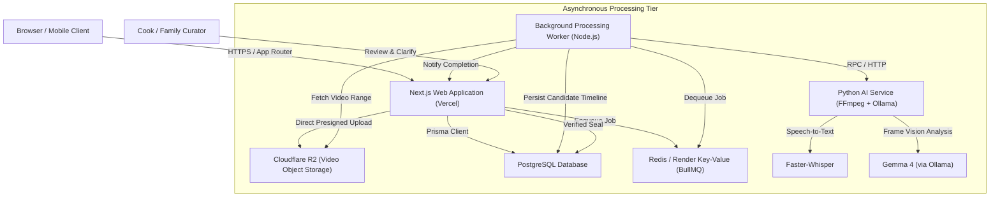
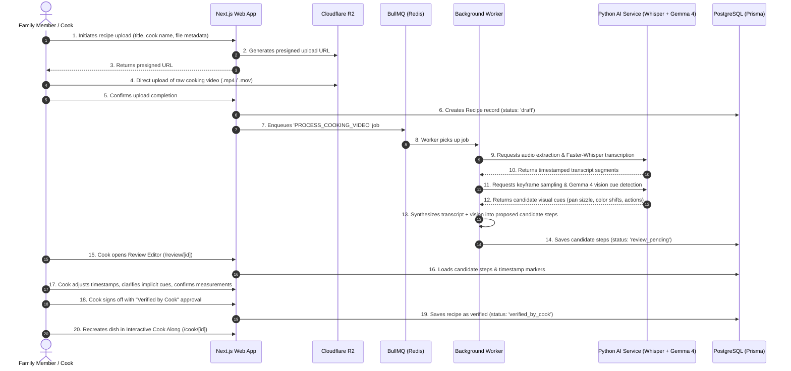
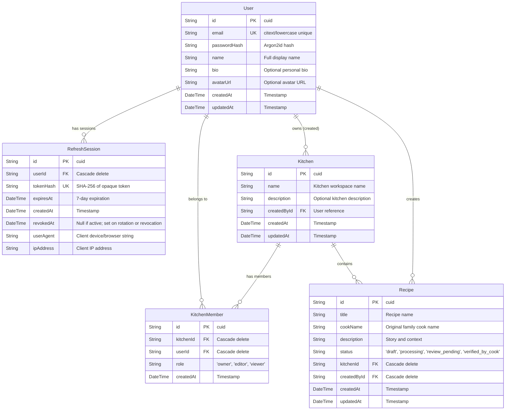
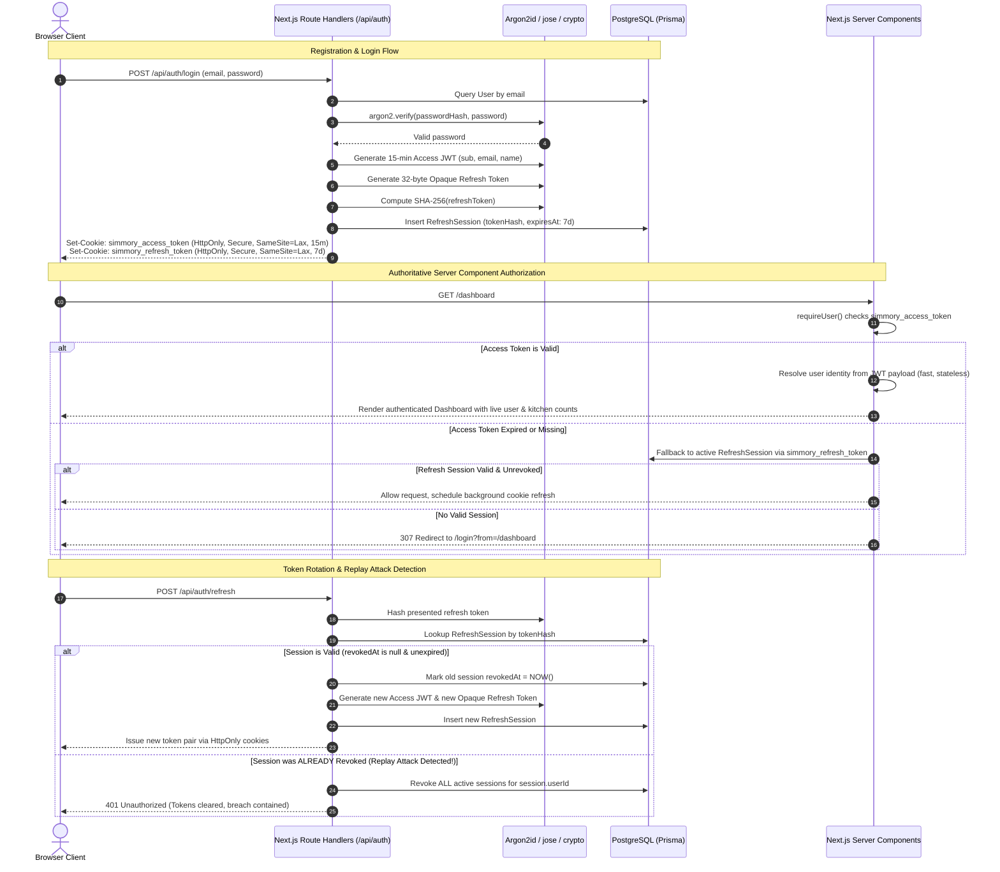
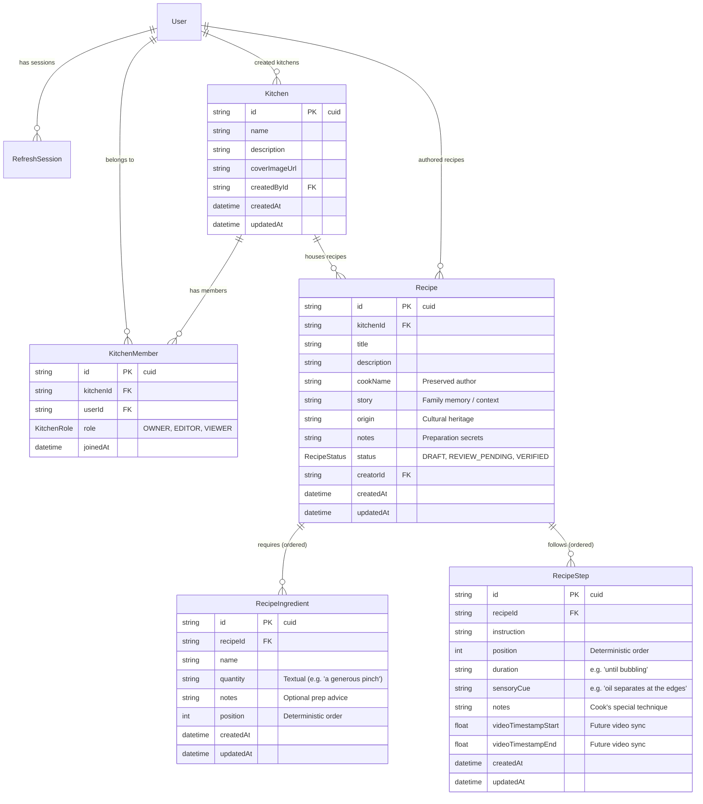

# Simmory — System Architecture & Technical Specifications

> **Product Philosophy:** *The way they made it, remembered.*  
> Simmory helps families capture, preserve, and reconstruct generational cooking knowledge without losing the original human experience.

---

## 1. Application Structure & Directory Organization

The frontend and initial web layer is architected as a Next.js App Router application in TypeScript with React 19, strict type safety, and Tailwind CSS. The codebase is organized by functional concern to maintain clean boundaries between server orchestration, presentation, and domain models.

```
simmory-web/
├── docs/
│   └── architecture.md               # System architecture and technical specifications
├── prisma/
│   ├── migrations/                   # PostgreSQL schema migrations (Phase 2 & Phase 3)
│   └── schema.prisma                 # Prisma schema (User, RefreshSession, Kitchen, KitchenMember, Recipe, RecipeIngredient, RecipeStep)
├── prisma.config.ts                  # Prisma 7 configuration (migrations & environment)
├── public/                           # Static assets, branding, and icons
├── src/
│   ├── app/                          # Next.js App Router (Server Components by default)
│   │   ├── api/
│   │   │   ├── account/              # Profile and password update Route Handlers
│   │   │   ├── auth/                 # register, login, refresh, logout, me Route Handlers
│   │   │   ├── kitchens/             # list, create, detail, update, delete, members
│   │   │   │   ├── [id]/
│   │   │   │   │   ├── members/
│   │   │   │   │   │   └── route.ts
│   │   │   │   │   └── route.ts
│   │   │   │   └── route.ts
│   │   │   └── recipes/              # list, create, detail, update, delete
│   │   │       ├── [id]/
│   │   │       │   └── route.ts
│   │   │       └── route.ts
│   │   ├── cook/
│   │   │   └── [id]/page.tsx         # Interactive Cook Along experience (video-linked)
│   │   ├── dashboard/
│   │   │   └── page.tsx              # Protected kitchen overview, activity, and stats
│   │   ├── kitchens/
│   │   │   ├── [id]/page.tsx         # Family Kitchen archive detail & recipe collection
│   │   │   └── page.tsx              # Protected Family Kitchen collections listing
│   │   ├── login/
│   │   │   └── page.tsx              # Editorial login page
│   │   ├── recipes/
│   │   │   ├── [id]/
│   │   │   │   ├── edit/page.tsx     # Recipe editor (ingredients, steps, sensory cues)
│   │   │   │   └── page.tsx          # Preserved recipe view (cues, story, ingredients)
│   │   │   ├── new/page.tsx          # Recipe creation page
│   │   │   └── page.tsx              # Protected recipe catalog with live search & filters
│   │   ├── register/
│   │   │   └── page.tsx              # Editorial registration page
│   │   ├── review/
│   │   │   └── [id]/page.tsx         # AI Recipe Review Editor
│   │   ├── settings/
│   │   │   └── page.tsx              # Protected account settings page
│   │   ├── upload/
│   │   │   └── page.tsx              # Protected video upload entry point
│   │   ├── globals.css               # Design system tokens & Tailwind v4 theme
│   │   ├── layout.tsx                # Root layout, Google fonts (Lora + Plus Jakarta), SEO
│   │   └── page.tsx                  # Public landing page
│   ├── components/
│   │   ├── account/                  # Settings form (profile & password)
│   │   ├── auth/                     # Login & Register editorial forms
│   │   ├── kitchens/                 # CreateKitchenDialog, KitchenSettingsDialog
│   │   ├── layout/                   # Application shells & layouts
│   │   ├── navigation/               # App header, authenticated sidebar, mobile drawer
│   │   ├── recipes/                  # RecipeForm, RecipeFilters, DeleteRecipeDialog
│   │   └── ui/                       # Design system tokens, buttons, inputs, cards, badges
│   ├── generated/
│   │   └── prisma/                   # Generated Prisma Client
│   ├── lib/
│   │   ├── auth/                     # JWT, password, session, cookies, permissions (RBAC)
│   │   ├── services/                 # Kitchens and Recipes domain service layer
│   │   ├── validations/              # Zod validation schemas (kitchen, recipe, auth)
│   │   ├── db.ts                     # Prisma Client singleton with pg.Pool adapter
│   │   ├── env.ts                    # Strict runtime environment validation
│   │   └── utils.ts                  # Pure utility functions
│   └── types/
│       └── index.ts                  # Core domain types
├── tests/
│   ├── integration/                  # Vitest live PostgreSQL auth, kitchens & recipes tests
│   └── unit/                         # Vitest unit tests (password, JWT, validation)
├── package.json
├── tsconfig.json
└── vitest.config.ts
```

### Architectural Principles:
1. **Server Components by Default:** Pages and layout containers execute on the server. Interactive client hooks (`useState`, `usePathname`) are strictly confined to leaf client components (`"use client"`).
2. **Partial Prerendering (PPR) & Streaming:** Dynamic parameters and client navigation hooks are enclosed within React `<Suspense>` boundaries to guarantee rapid static HTML delivery with dynamic client hydration.
3. **Zero Fabrication:** The user interface never simulates fake progress bars, fake AI observations, or fabricated recipes. Empty and in-progress states remain honest and informative.

---

## 2. Planned Infrastructure & Service Topology

The production architecture separates interactive user-facing web requests from heavyweight asynchronous video and AI processing workloads.



### Component Roles:
- **Next.js Web Application (Vercel):** Serves Server Components, renders the design system, hosts Route Handlers (`/api/...`), and issues custom JWT authentication sessions.
- **PostgreSQL & Prisma ORM:** Relational database preserving user accounts, kitchen workspaces, cook profiles, confirmed recipe steps, sensory cues, and audit trails.
- **Cloudflare R2:** High-throughput, S3-compatible object storage for raw cooking video footage, optimized HLS streaming segments, and video thumbnails without egress fees.
- **BullMQ on Redis (Render Key Value):** Robust job queue managing asynchronous video ingestion, transcription, frame extraction, and timeline synthesis.
- **Python AI Service:** Dedicated microservice encapsulating the local Python proof-of-concept (FFmpeg audio extraction, Faster-Whisper, and Gemma 4 vision inference).

---

## 3. Separation Between Next.js and the Python AI Worker

To ensure Next.js remains responsive, low-latency, and serverless-friendly, all compute-heavy machine learning and media transformation operations are isolated into a standalone Python service.

| Concern | Next.js Web App | Python AI Service |
| :--- | :--- | :--- |
| **Primary Runtime** | Node.js / Vercel Edge / Serverless | Long-running container (Python 3.11+, GPU/CUDA optional) |
| **Responsibilities** | UI rendering, JWT auth, route security, recipe CRUD, cook review actions | Audio demuxing, Faster-Whisper transcription, frame sampling, Gemma 4 vision analysis |
| **Communication** | Enqueues jobs to Redis (BullMQ); polls/receives webhook updates | Reads job payload from queue / internal REST endpoint, writes progress events |
| **Failure Isolation** | Server crashes or video decoding timeouts in Python cannot impact web availability | Heavy GPU/CPU spikes do not degrade website response times |

---

## 4. End-to-End Cooking Video Processing Workflow



---

## 5. Security Boundaries & Data Isolation

### 1. Authentication & Session Security (Phase 2+)
- **Custom JWT Sessions via `jose`:** Stateless, cryptographically signed tokens stored in `HttpOnly`, `Secure`, `SameSite=Lax` cookies.
- **Strictly No Auth.js / NextAuth:** Minimal, audited custom session middleware verifying user claims and token expiration on protected Route Handlers.
- **No Secrets on Client:** API keys, database credentials, R2 secret keys, and JWT signing secrets remain accessible only to server runtimes via environment variables.

### 2. Media Upload & Access Control
- **Direct Presigned R2 Uploads:** Video files stream directly from the client browser to Cloudflare R2 via short-lived (15-minute) presigned URLs. Video payloads never pass through or saturate Next.js server memory.
- **Private Video Delivery:** Video playback in the Cook Along experience uses signed CDN tokens or authorized streaming proxies to guarantee unlisted family videos remain private.

### 3. Family Kitchen Boundary Isolation
- Every recipe and video belongs strictly to a `KitchenId`.
- Access control checks enforce that users can only view, review, or edit recipes belonging to kitchens where they have verified membership or creator ownership.

### 4. Human-in-the-Loop AI Boundary
- Raw AI transcripts and vision classifications are labeled internally as `is_candidate: true`.
- An AI observation is **never** presented to family members as confirmed instruction until a human user completes the review workflow.

---

## 6. Phase 2 Architecture: Database, JWT Authentication & User Management

Phase 2 replaces the static placeholder authentication and mock states with a production-grade PostgreSQL relational database layer, Prisma ORM, custom JWT authentication, Argon2id password hashing, opaque refresh-token rotation with replay detection, and server-side route authorization.

### 6.1 Database Schema (Prisma ORM & PostgreSQL)

The schema is defined in [`prisma/schema.prisma`](file:///Users/macbook/simmory-web/prisma/schema.prisma) and managed through Prisma 7 using `@prisma/adapter-pg` with a pooled PostgreSQL client ([`src/lib/db.ts`](file:///Users/macbook/simmory-web/src/lib/db.ts)).



#### Key Schema Decisions & Indexes:
1. **Case-Insensitive Unique Emails:** `User.email` is normalized to lowercase in Zod validation schemas and constrained unique in PostgreSQL.
2. **Hashed Refresh Tokens:** Refresh tokens stored in `RefreshSession` are stored exclusively as 64-character SHA-256 hex digests (`tokenHash`). Even if the database is compromised, plaintext refresh tokens cannot be extracted.
3. **Foreign Key Cascades:** `onDelete: Cascade` is applied to all subordinate relations (`RefreshSession`, `KitchenMember`, `Recipe`) ensuring clean garbage collection without orphaned records.
4. **Strategic Indexes:**
   - `User(email)`
   - `RefreshSession(userId)`, `RefreshSession(tokenHash)`, `RefreshSession(expiresAt)`
   - `Kitchen(createdById)`
   - `KitchenMember(kitchenId)`, `KitchenMember(userId)`, `KitchenMember(kitchenId, userId)` (Unique compound index)
   - `Recipe(kitchenId)`, `Recipe(createdById)`, `Recipe(status)`

---

### 6.2 Authentication & Session Lifecycle

Simmory strictly rejects third-party managed auth providers (NextAuth/Auth.js, Clerk, Firebase, Supabase) in favor of a minimal, auditable, standard-compliant cryptographic authentication system built with `jose` and `@node-rs/argon2`.



#### Token Characteristics:
- **Access Token:**
  - Standard: JWT signed with HMAC-SHA256 (`HS256`) via `jose`
  - Lifetime: 15 minutes (`15m`)
  - Payload: `{ sub: string, email: string, name: string, iat: number, exp: number }`
  - Cookie: `simmory_access_token` (`HttpOnly`, `SameSite=Lax`, `Path=/`, `Secure` in production)
- **Refresh Token:**
  - Standard: 32-byte cryptographically secure random opaque token (64 hex characters)
  - Lifetime: 7 days (`7d`)
  - Storage: SHA-256 hash stored in `RefreshSession.tokenHash`
  - Cookie: `simmory_refresh_token` (`HttpOnly`, `SameSite=Lax`, `Path=/api/auth`, `Secure` in production)
- **Password Hashing:**
  - Algorithm: Argon2id via `@node-rs/argon2`
  - Parameters: Memory cost = 65,536 KiB (64 MiB), Time cost = 3 iterations, Parallelism = 4 threads.

---

### 6.3 Security Defenses & Hardening

1. **Replay Attack Detection:**
   When an access token expires, the client calls `/api/auth/refresh`. If an attacker attempts to reuse an older refresh token that was already rotated (`revokedAt !== null`), the system flags a session replay attack and **immediately revokes every active session for that user**, logging out all sessions and neutralizing the stolen credential.
2. **CSRF & Origin Verification:**
   All mutating state routes (`POST`, `PUT`, `PATCH`, `DELETE` under `/api/*`) validate the `Origin` and `Referer` headers against the application's base URL ([`src/lib/auth/origin.ts`](file:///Users/macbook/simmory-web/src/lib/auth/origin.ts)) to block cross-site request forgery.
3. **Open Redirect Prevention:**
   The `from` query parameter used in login/registration redirects is sanitized via [`src/lib/auth/redirect.ts`](file:///Users/macbook/simmory-web/src/lib/auth/redirect.ts). It permits only safe relative internal application paths (e.g., `/dashboard`, `/upload`) and rejects external protocol prefixes (`https://`, `//`, `javascript:`).
4. **Strict Server-Side Authorization:**
   Client code is never trusted to assert auth state. Protected server components execute `requireUser()` inside React `<Suspense>` boundaries to verify the cookie server-side before rendering protected layouts or data.

---

### 6.4 API Endpoints Specification

| Route | Method | Access | Purpose |
| :--- | :--- | :--- | :--- |
| `/api/auth/register` | `POST` | Public | Validates email/password/name, creates user, provisions default kitchen, sets auth cookies |
| `/api/auth/login` | `POST` | Public | Verifies email and Argon2id hash, creates refresh session, sets auth cookies |
| `/api/auth/refresh` | `POST` | Public (Cookie) | Rotates refresh token, detects replay attacks, issues new token pair cookies |
| `/api/auth/logout` | `POST` | Authenticated | Revokes database refresh session, clears auth cookies |
| `/api/auth/me` | `GET` | Authenticated | Returns current authenticated user identity and primary kitchen |
| `/api/account/profile` | `PATCH` | Authenticated | Updates user's display name and optional biography |
| `/api/account/password` | `PATCH` | Authenticated | Verifies existing password and updates to newly hashed Argon2id password |

---

### 6.5 Testing & Verification Matrix

The authentication and database systems are verified by automated Vitest integration and unit suites executing against a live PostgreSQL test database:

| Test Suite | File | Tests | Coverage |
| :--- | :--- | :--- | :--- |
| **Password Hashing** | `tests/unit/password.test.ts` | 5 | Argon2id hash generation, verification, rejection of mismatched passwords |
| **JWT & Tokens** | `tests/unit/jwt.test.ts` | 6 | Sign, verify, expiration enforcement, opaque token hashing, tamper rejection |
| **Validation Schemas** | `tests/unit/validation.test.ts` | 8 | Email normalization, password strength (8+ chars, lowercase, uppercase, number), profile updates |
| **Auth Integration** | `tests/integration/auth-flow.test.ts` | 5 | End-to-end DB user creation, default kitchen provisioning, token rotation, replay attack revocation |
| **API Endpoints** | `tests/integration/api-routes.test.ts` | 6 | HTTP register, duplicate email handling, login, logout cookie clearance, /api/auth/me |
| **Total** | | **30 passing** | **Complete coverage of core auth mechanics** |

---

### 6.6 Production Deployment & Rate Limiting Recommendations

For high-concurrency production deployments (e.g. Vercel + AWS RDS / Neon / Supabase PostgreSQL):
1. **Distributed Rate Limiting:**
   Auth endpoints (`/api/auth/login`, `/api/auth/register`) should be gated behind an IP and email-based rate limiter (such as Upstash Redis or Cloudflare Turnstile / WAF) configured for 5 login attempts per IP per minute to prevent brute-force credential stuffing.
2. **Connection Pooling:**
   Prisma 7 with `@prisma/adapter-pg` uses a pooled `pg.Pool`. In serverless environments (AWS Lambda / Vercel Edge), configure an external connection pooler (such as PgBouncer or AWS RDS Proxy) and limit `max: 10` per serverless instance to prevent connection starvation.
3. **Automated Session Pruning:**
   Implement a nightly scheduled cron job (`DELETE FROM "RefreshSession" WHERE "expiresAt" < NOW()`) to prune expired sessions and maintain minimal table bloat.

---

## 7. Phase 3: Family Kitchen & Recipe Domain Architecture

Phase 3 transitions Simmory from an authenticated skeleton into a persistent, multi-tenant family cooking archive. It codifies the relational boundaries of family kitchens, role-based access control, and human cooking knowledge preservation.

### 7.1 Relational Data Model

The domain model is structured in PostgreSQL via Prisma 7 to enforce data integrity and cascade deletions deterministically.



### 7.2 Cooking Knowledge Preservation Philosophy

Simmory exists because conventional recipe databases force traditional culinary heritage into rigid, metric molds (e.g. "250ml", "10 grams") that misrepresent how families actually cook.

1. **Qualitative Textual Quantities:**
   - Ingredients store quantities as free text (`quantity: "A handful"`, `"Enough water to cover the rice by a finger's joint"`, `"2 large onions"`).
   - Users are never forced to fabricate artificial numeric values or standard units when the original cook worked by touch, sight, or habit.
2. **Sensory Cues over Timers:**
   - Instead of generic durations like "cook for 7 minutes," recipes prioritize human sensory checkpoints:
     - *Visual:* "Until the onions turn translucent with amber edges."
     - *Tactile:* "Until the dough pushes back gently when pressed."
     - *Auditory:* "When the sizzle softens to a gentle murmur."
     - *Olfactory:* "When the nutty toasted aroma fills the room."
   - These cues are preserved as distinct first-class fields on `RecipeStep` and highlighted visually in the recipe reading and cook-along experiences.
3. **Personal Memories & Provenance:**
   - Every recipe captures the `cookName` (e.g. "Grandma Sofia", "Aunt Mei") and an optional `story` celebrating why and how the recipe came to be.

### 7.3 Role-Based Access Control (RBAC) & IDOR Prevention

Multi-tenancy is enforced strictly at the database layer through the service abstraction (`src/lib/auth/permissions.ts` and `src/lib/services/*`). Client-provided IDs are never trusted as proof of ownership.

#### Role Hierarchy:
| Role | View Kitchen & Recipes | Create/Edit Recipes | Delete Recipes | Update Kitchen Settings | Delete Kitchen |
| :--- | :---: | :---: | :---: | :---: | :---: |
| **OWNER** | Yes | Yes | Yes | Yes | Yes |
| **EDITOR** | Yes | Yes | Yes | No | No |
| **VIEWER** | Yes | No | No | No | No |

#### Core Permission Utilities:
- `requireKitchenMember(userId, kitchenId)`: Verifies user is an active member (`OWNER`, `EDITOR`, or `VIEWER`). Throws `403 Forbidden` or `404 Not Found` if access is denied.
- `requireKitchenEditor(userId, kitchenId)`: Requires role of `OWNER` or `EDITOR`. Rejects `VIEWER` mutations.
- `requireKitchenOwner(userId, kitchenId)`: Requires role of `OWNER`. Used for kitchen renaming, description updates, and deletion.
- `getRecipeWithAccess(userId, recipeId)`: Fetches a recipe while joining through the associated `Kitchen` and checking membership for `userId` in a single query. Prevents Insecure Direct Object References (IDOR).
- `canEditRecipe(userId, recipeId)`: Confirms user has edit permissions (`OWNER` or `EDITOR` of the containing kitchen) before mutating ingredients, steps, or metadata.

### 7.4 Phase 3 API Specifications

#### Kitchen Management:
| Route | Method | Access | Description |
| :--- | :--- | :--- | :--- |
| `/api/kitchens` | `GET` | Authenticated | Lists all kitchens where the user is an active member with recipe and member counts |
| `/api/kitchens` | `POST` | Authenticated | Creates a new kitchen and assigns the creator as `OWNER` atomically in a transaction |
| `/api/kitchens/[id]` | `GET` | Member | Returns kitchen details, recipe list, and member roles |
| `/api/kitchens/[id]` | `PATCH` | Owner | Updates kitchen name and description |
| `/api/kitchens/[id]` | `DELETE` | Owner | Deletes kitchen and cascades all recipes, ingredients, steps, and memberships |
| `/api/kitchens/[id]/members` | `GET` | Member | Returns the list of members and their roles for the kitchen |

#### Recipe Management:
| Route | Method | Access | Description |
| :--- | :--- | :--- | :--- |
| `/api/recipes` | `GET` | Authenticated | Returns paginated recipes across user's kitchens with search and filter parameters |
| `/api/recipes` | `POST` | Editor/Owner | Creates a recipe with nested ingredients and steps in an atomic transaction |
| `/api/recipes/[id]` | `GET` | Member | Returns full recipe details, ingredients, steps, sensory cues, and kitchen context |
| `/api/recipes/[id]` | `PATCH` | Editor/Owner | Updates recipe metadata, ingredients, and steps with atomic replacement |
| `/api/recipes/[id]` | `DELETE` | Editor/Owner | Deletes recipe and cascades ingredients and steps |

---

### 7.5 Automated Verification Suite

All Phase 1, Phase 2, and Phase 3 capabilities are verified with automated tests:

| Test Suite | File | Tests | Coverage |
| :--- | :--- | :--- | :--- |
| **Password Hashing** | `tests/unit/password.test.ts` | 5 | Argon2id hashing, verification, invalid passwords |
| **JWT & Tokens** | `tests/unit/jwt.test.ts` | 6 | Sign, verify, expiration, opaque token hashing, tamper rejection |
| **Validation Schemas** | `tests/unit/validation.test.ts` | 8 | Email normalization, password strength, profile updates |
| **Auth Integration** | `tests/integration/auth-flow.test.ts` | 5 | DB registration, default kitchen provisioning, token rotation, replay revocation |
| **Auth API Endpoints** | `tests/integration/api-routes.test.ts` | 6 | HTTP register, duplicate email handling, login, logout cookie clearance, /api/auth/me |
| **Kitchens & Recipes Services** | `tests/integration/kitchens-and-recipes.test.ts` | 8 | Multi-kitchen creation, membership enforcement, recipe CRUD, sensory cues, cascade delete |
| **Kitchens & Recipes API** | `tests/integration/api-kitchens-recipes.test.ts` | 7 | HTTP /api/kitchens and /api/recipes CRUD, search/filter, role permissions, IDOR cross-tenant isolation |
| **Total** | | **45 passing** | **Complete end-to-end verification across unit, service, and API layers** |

