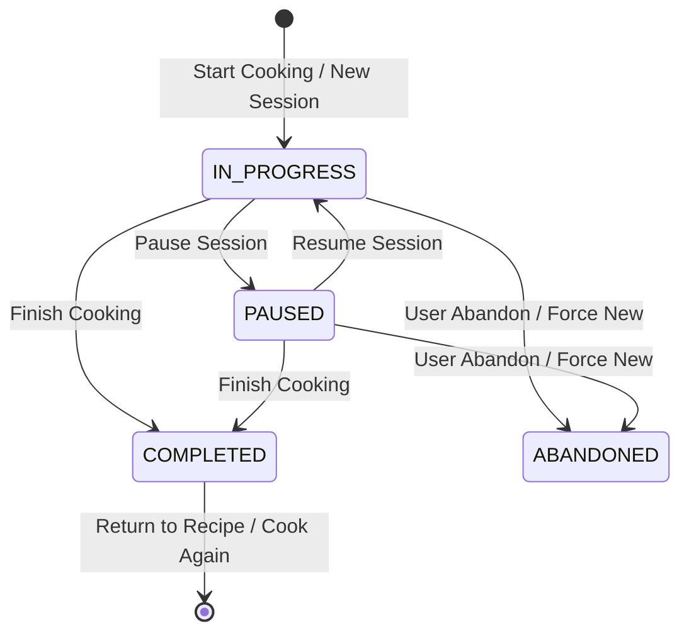

# Simmory — Interactive Cook Along Experience (Phase 8 Architecture)

> **Product Vision:** *The way they made it, remembered.*  
> Simmory's Interactive Cook Along allows family members to recreate traditional dishes step-by-step alongside the recorded guidance, sensory cues, and authentic measurements of the original family cook.

---

## 1. Overview & Architectural Philosophy

Phase 8 completes the end-to-end journey:
$$\text{Upload} \longrightarrow \text{Analyze} \longrightarrow \text{Review} \longrightarrow \text{Preserve} \longrightarrow \textbf{Cook Along}$$

### The Core Philosophy
1. **AI proposes. Humans clarify. Evidence supports. Families preserve.**
2. **Never fabricate missing data**: No invented temperatures, metricized approximations of traditional measurements (e.g. "a handful"), or simulated durations.
3. **Truthful Verification**: Completing a cooking session records personal culinary accomplishment, but **never** forges cook verification (`cookVerified` or `VERIFIED_BY_COOK`).
4. **Resilient Personal Sessions**: Cooking progress belongs strictly to the individual user. One family member cooking a recipe never overwrites another member's progress.

---

## 2. Route & Canonical Design

### Canonical Route
- `/cook/[id]`
- The parameter `[id]` represents a **Recipe ID** (UUID), **never** a video ID or an AI analysis ID.
- Accessing `/cook/[id]` dynamically loads the authorized recipe, steps with linked `RecipeEvidence`, qualitative ingredients, temporary signed video playback tokens, and any existing active `CookingSession` for the current user.

### Cross-System Integration Points
- **Recipe Detail Page (`/recipes/[id]`)**: Displays prominent "Start Cooking" or "Continue Cooking" buttons depending on whether the user has an active session. Shows step counts, sensory cue badges, and video availability.
- **Family Kitchen View (`/kitchens/[id]`)**: Direct "Cook" action on each recipe card.
- **Dashboard (`/dashboard`)**: Dedicated "Continue Cooking — Active Session" section when an incomplete session exists for the user.
- **Review Workspace (`/review/[id]`)**: Upon conversion of reviewed footage to a preserved recipe, presents a prominent banner linking directly to `/cook/[recipeId]`.

---

## 3. Database Architecture & Schema Models

Implemented via PostgreSQL & Prisma 7 (`20261014184402_add_cooking_session_models`):

```prisma
enum CookingSessionStatus {
  IN_PROGRESS
  PAUSED
  COMPLETED
  ABANDONED
}

model CookingSession {
  id                  String               @id @default(uuid()) @db.Uuid
  recipeId            String               @db.Uuid
  recipe              Recipe               @relation(fields: [recipeId], references: [id], onDelete: Cascade)
  userId              String               @db.Uuid
  user                User                 @relation(fields: [userId], references: [id], onDelete: Cascade)
  kitchenId           String               @db.Uuid
  kitchen             Kitchen              @relation(fields: [kitchenId], references: [id], onDelete: Cascade)
  status              CookingSessionStatus @default(IN_PROGRESS)
  currentStepId       String?              @db.Uuid
  currentStep         RecipeStep?          @relation(fields: [currentStepId], references: [id], onDelete: SetNull)
  currentStepPosition Int                  @default(0)
  version             Int                  @default(1)
  startedAt           DateTime             @default(now())
  lastActivityAt      DateTime             @default(now())
  completedAt         DateTime?
  createdAt           DateTime             @default(now())
  updatedAt           DateTime             @updatedAt

  sessionSteps        CookingSessionStep[]
  sessionIngredients  CookingSessionIngredient[]

  @@index([userId, recipeId, status])
  @@index([recipeId])
  @@index([kitchenId])
  @@map("cooking_sessions")
}

model CookingSessionStep {
  id          String         @id @default(uuid()) @db.Uuid
  sessionId   String         @db.Uuid
  session     CookingSession @relation(fields: [sessionId], references: [id], onDelete: Cascade)
  stepId      String         @db.Uuid
  step        RecipeStep     @relation(fields: [stepId], references: [id], onDelete: Cascade)
  completed   Boolean        @default(true)
  completedAt DateTime       @default(now())
  createdAt   DateTime       @default(now())
  updatedAt   DateTime       @updatedAt

  @@unique([sessionId, stepId])
  @@index([sessionId])
  @@map("cooking_session_steps")
}

model CookingSessionIngredient {
  id           String           @id @default(uuid()) @db.Uuid
  sessionId    String           @db.Uuid
  session      CookingSession   @relation(fields: [sessionId], references: [id], onDelete: Cascade)
  ingredientId String           @db.Uuid
  ingredient   RecipeIngredient @relation(fields: [ingredientId], references: [id], onDelete: Cascade)
  checked      Boolean          @default(true)
  checkedAt    DateTime         @default(now())
  createdAt    DateTime         @default(now())
  updatedAt    DateTime         @updatedAt

  @@unique([sessionId, ingredientId])
  @@index([sessionId])
  @@map("cooking_session_ingredients")
}
```

---

## 4. Cooking Session Lifecycle & Resume Architecture

### Session Transitions


### Resume Mechanics
1. **Detection**: When loading a recipe or calling `POST /api/cook-sessions`, the service searches for an existing `IN_PROGRESS` or `PAUSED` session owned by the authenticated `userId`.
2. **Reconciliation**:
   - `sessionSteps` records which specific `stepId`s have been completed.
   - `sessionIngredients` records which `ingredientId`s have been prepped.
   - `currentStepPosition` points to the user's active step.
   - If steps were re-ordered or modified, stable UUIDs guarantee that progress remains associated with the correct step.
3. **Multi-Session Disambiguation**:
   - If an active session exists, the UI presents a "Resume Session" banner showing elapsed time and progress, alongside a "Start Fresh" option (`forceNew: true`) which marks the prior session as `ABANDONED` without destroying historical records.
4. **Optimistic Concurrency Control**:
   - Each state transition increments `version`.
   - Client sends `expectedVersion` when advancing steps.
   - 409 Conflict returns if another browser tab advanced the session, triggering automatic state reload.

---

## 5. Video Synchronization & Playback Architecture

### Step-to-Video Linking
- Recipe steps originate from reviewed footage via `RecipeEvidence`.
- When a step is displayed:
  - If `step.evidence` exists, the UI shows the exact video moment: `MM:SS` (or `MM:SS – MM:SS`).
  - Clicking **"Watch Demonstration"** or **"Replay this moment"** triggers video seeking to `startTimestamp`.
  - The video player waits for `seeked` events before playing, avoiding WebKit/Safari resets to `00:00`.
- **Multiple Video Source Support**:
  - `getRecipeCookAlongData` maps all distinct video references across all steps.
  - Automatically loads authorized playback streams per video.
  - Switches video source cleanly when moving between steps recorded in different video files.
- **Honest No-Video Fallback**:
  - For handwritten family recipes without video, renders an editorial card: *"Handwritten Family Recipe — No synchronized recording attached. Follow the verified written instructions and sensory cues."*
  - Never displays broken video players or fake placeholders.

---

## 6. Monotonic Cooking Timers

Cooking in a kitchen involves background browser tabs and locked screens. Traditional `setInterval(..., 1000)` drifts or pauses when tabs are backgrounded.

### Implementation Strategy
1. **Monotonic Deadlines**:
   $$\text{targetDeadline} = \text{Date.now()} + \text{remainingSeconds} \times 1000$$
2. **Visibility Change Synchronization**:
   - Listens to `document.addEventListener('visibilitychange')`.
   - When tab regains focus, recalculates remaining time directly against `Date.now()`.
3. **Sound Chime Notification**:
   - Uses native Web Audio API (`AudioContext`) with synthesized melodic bells (587.33 Hz $\rightarrow$ 880 Hz).
   - No external sound assets required; zero network overhead.
4. **Duration Parsing**:
   - Unambiguous numeric durations (e.g. "20 minutes", "10-15 minutes") generate presets.
   - Qualitative durations (e.g. "Until golden brown", "Until oil rises") do not force arbitrary countdowns; users can set custom manual timers.

---

## 7. Sensory Cooking Cues & Traditional Measurements

### Sensory Cues ("How You'll Know It's Ready")
Traditional cooks rarely use thermometers; they rely on sight, sound, aroma, and texture:
- *"Listen for the gentle bubbling rhythm."*
- *"The rice will suddenly release from the pot edges in one unified, glossy mound."*
- Sensory cues are rendered with an editorial card distinguished by warm terracotta and amber tones, separated from ordinary instructions.

### Qualitative Ingredients (Mise en Place Checklist)
- Preserves the original cook's language: *"A generous handful"*, *"Two knuckle-depths of water"*, *"A pinch of dawadawa"*.
- Users can check off ingredients before cooking starts.
- Checklist progress persists to PostgreSQL in `CookingSessionIngredient`.

---

## 8. Focus Mode

Designed for active kitchen use on tablets and phones:
- Distraction-free high-contrast typography.
- Prominent step number and instruction.
- Large touch targets for "Previous", "Next", and "Mark Complete".
- One-tap video demonstration jump.
- Built-in timer floating drawer.
- Toggle between Standard and Focus mode at any time with keyboard shortcut (`F` or `Escape`).

---

## 9. Security & Authorization

| Role | Kitchen Access | Cook Along Permission | Can Mutate Recipe |
|---|---|---|---|
| **OWNER** | Full | Can start / complete personal sessions | Yes |
| **EDITOR** | Full | Can start / complete personal sessions | Yes |
| **VIEWER** | Read-Only | Can start / complete personal sessions | **No (Forbidden)** |
| **Non-Member** | Denied | 404 / 403 Forbidden | Denied |

- **IDOR Protection**: All session routes verify `session.userId === currentUser.id`.
- **Cross-Kitchen Boundary**: Recipe accessibility checked via `requireKitchenMember(recipe.kitchenId, userId)`.
- **Step & Ingredient Integrity**: `stepId` and `ingredientId` are validated against `session.recipeId`; foreign IDs are rejected with 400.

---

## 10. Verification & Test Coverage

- **TypeScript / Vitest**: 15 test suites, 117 passing tests (`tests/integration/cook-along.test.ts` covers 13 comprehensive end-to-end scenarios).
- **Python AI Suite**: 17 passing tests (`services/ai/tests/`).
- **Live PostgreSQL Integration**: Verified session lifecycle, step completion, ingredient checklist, monotonic timer parsing, and truthful verification status against running server.
- **Production Build**: 0 errors with Turbopack across 32 routes.

---

## 11. Known Limitations & Next Steps

1. **Hardware Wake Lock**: Browser screen dimming can be further enhanced using the experimental Screen Wake Lock API (`navigator.wakeLock`) where supported.
2. **Multi-Recording Step Merging**: When a single step spans two separate video recordings, playback switches sequentially rather than as a multi-angle picture-in-picture.
3. **Voice Control**: Voice commands ("next step", "pause timer") are intentionally excluded in Phase 8 to ensure reliable touch-first usability in noisy kitchen environments.
