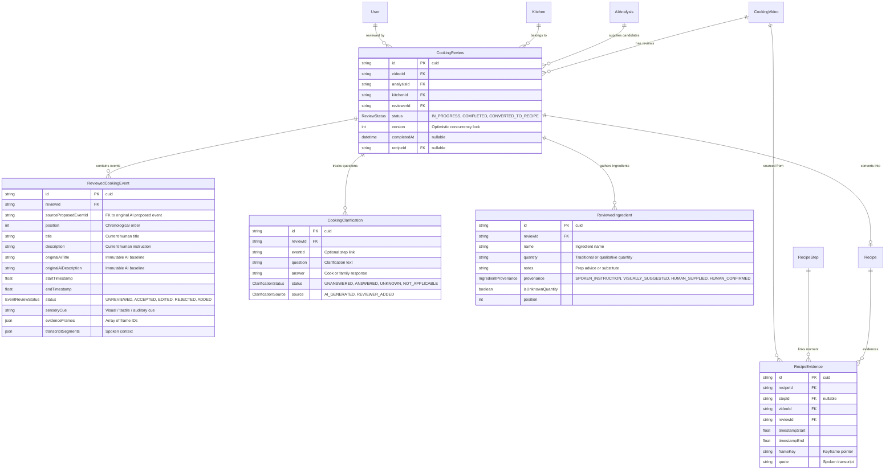

# Simmory — Phase 7: Human Recipe Review, Reconstruction & Verification

## 1. Product Philosophy & Guiding Principles

> **"AI proposes. Humans clarify. Evidence supports. Families preserve."**

In traditional recipe apps and generic AI tools, AI models frequently invent exact metric measurements (e.g., "add 250ml of water", "stir for exactly 7 minutes"), stripping away the intuition and wisdom of the cook.

Simmory rejects this approach. Family cooking recipes rarely live in standardized metric recipes; they live in:
- The intuition of how thick the paste feels against the wooden spoon.
- The auditory sizzle when water hits hot palm oil.
- Spoken instructions passed down across generations.
- Visual changes when the stew "breaks" or the starch becomes glossy.

In Phase 7, Simmory implements the complete **Human-in-the-Loop Recipe Reconstruction** workflow. AI is treated strictly as an assistant that surfaces candidate stages and questions. The family member reviews, corrects, adds context, clarifies ambiguities, and ultimately converts reviewed moments into an heirloom family recipe.

---

## 2. Core Relational Architecture

The human review process is modeled in PostgreSQL via Prisma 7 to maintain an immutable audit trail between original AI predictions and human corrections.



---

## 3. Human Review Workflow Lifecycle

```
[Completed AI Analysis]
          │
          ▼
   1. Initialize Review (POST /api/videos/[id]/review)
          │  - Copies proposed AI events into ReviewedCookingEvent (status: UNREVIEWED)
          │  - Copies AI questions into CookingClarification (status: UNANSWERED)
          │  - Preserves immutable originalAiTitle & originalAiDescription
          ▼
   2. Interactive Review Workspace (/review/[id])
          ├── Left Panel: Sticky Private Video Player with frame-accurate seeking
          └── Right Panel: Event Cards, Clarifications, Ingredients, Heirloom Drawer
                │
                ├─► Accept Event (Status -> ACCEPTED)
                ├─► Edit Title/Desc/Cue (Status -> EDITED, original AI preserved)
                ├─► Add Missing Step (Status -> ADDED)
                ├─► Reject Event (Status -> REJECTED, excluded from final recipe)
                ├─► Answer Clarification (Natural language, UNKNOWN, or NOT_APPLICABLE)
                └─► Add Traditional Ingredients (e.g., "A finger's depth of cold water")
          ▼
   3. Complete Review (POST /api/reviews/[reviewId]/complete)
          │  - Validates that NO events remain in UNREVIEWED status
          │  - Sets CookingReview.status = COMPLETED
          ▼
   4. Recipe Conversion (POST /api/reviews/[reviewId]/recipe)
          ├── Mode: CREATE_NEW
          │     - Inserts Recipe with family heritage metadata (cookName, story, origin)
          │     - Inserts RecipeStep for ACCEPTED, EDITED, ADDED events (REJECTED omitted)
          │     - Links RecipeEvidence records with video timestamps
          │     - Inserts RecipeIngredient records
          └── Mode: MERGE_EXISTING
                - Appends reviewed steps to existing recipe without destructive overwrites
          │
          ▼
   5. Verification Semantics
          - Default status: REVIEW_PENDING (Acknowledges human review)
          - If explicit cook attestation is provided: VERIFIED_BY_COOK
```

---

## 4. Key Architectural Features

### 4.1 Non-Destructive AI Provenance
When a reviewer edits an AI event, the application does not overwrite the machine-generated hypothesis. Instead, `originalAiTitle` and `originalAiDescription` remain permanently recorded in the database. 

Reviewers can expand the **"Compare Original AI Proposal"** drawer at any time to review what the vision and audio models initially proposed.

### 4.2 Rejection vs. Deletion
Clicking "Reject" on an AI proposal does not delete the database row. It transitions `status` to `REJECTED`. This preserves the historical audit trail of what was inspected and explicitly discarded. When converting the review into a structured `Recipe`, `REJECTED` events are automatically excluded from `RecipeStep` generation.

### 4.3 Qualitative Ingredients & Sensory Cues
Simmory never forces arbitrary numbers on cooking heritage. Ingredients support qualitative text (`quantity: "A generous pinch"`, `"Small handful"`, `"2 shallow wooden spoons"`). Cues such as *"Bubbles turn thick and pop slowly"* or *"Steam smells nutty and sweet"* are stored as first-class fields on `RecipeStep` and highlighted throughout the application.

### 4.4 Optimistic Concurrency Control
`CookingReview` includes an incrementing `version` column. All mutating review APIs accept an optional `expectedVersion`. If another family editor updates the review concurrently, the server returns `409 Conflict`, prompting the UI to reload changes safely without overwriting family inputs.

### 4.5 Strict Verification Semantics
Unlike generic AI generators that mark recipes "verified" automatically:
- Recipes created from reviews are marked `REVIEW_PENDING` (Human Reviewed).
- Only when an authorized family editor explicitly certifies that the original cook or their appointed proxy confirmed the details is the badge updated to `VERIFIED_BY_COOK` (`cookVerified: true`, `cookVerifiedBy: "Mama Amina"`).

---

## 5. API Reference

| Endpoint | Method | Role | Description |
| :--- | :---: | :---: | :--- |
| `/api/videos/[id]/review` | `GET` | Kitchen Member | Returns active review or creates one if caller is OWNER/EDITOR |
| `/api/videos/[id]/review` | `POST` | Owner/Editor | Explicitly initializes review from completed AI analysis |
| `/api/reviews/[reviewId]` | `GET` | Kitchen Member | Retrieves complete review payload with events, questions, and ingredients |
| `/api/reviews/[reviewId]` | `PATCH` | Owner/Editor | Updates review metadata with optimistic concurrency check |
| `/api/reviews/[reviewId]/events` | `POST` | Owner/Editor | Adds a new human-observed cooking step (`status: ADDED`) |
| `/api/reviews/[reviewId]/events/[eventId]` | `PATCH` | Owner/Editor | Accepts, edits, or updates timestamps/cues for an event |
| `/api/reviews/[reviewId]/events/[eventId]` | `DELETE` | Owner/Editor | Rejects AI event (`REJECTED`) or removes human-added event |
| `/api/reviews/[reviewId]/events/reorder` | `POST` | Owner/Editor | Reorders chronological positions of cooking events |
| `/api/reviews/[reviewId]/clarifications` | `POST` | Owner/Editor | Answers clarification or creates custom reviewer question |
| `/api/reviews/[reviewId]/ingredients` | `POST` | Owner/Editor | Creates or updates qualitative ingredient specification |
| `/api/reviews/[reviewId]/ingredients/[id]` | `DELETE` | Owner/Editor | Removes a reviewed ingredient |
| `/api/reviews/[reviewId]/complete` | `POST` | Owner/Editor | Marks review as COMPLETED (requires 0 UNREVIEWED events) |
| `/api/reviews/[reviewId]/recipe` | `POST` | Owner/Editor | Atomically converts reviewed events into Recipe, RecipeStep, RecipeEvidence |

---

## 6. Verification and Test Matrix

Automated Vitest integration tests in `tests/integration/recipe-review.test.ts` verify all Phase 7 mechanics against a live PostgreSQL test database:

1. **Review Initialization:** Copies proposed events and clarifications; rejects videos lacking completed AI analysis.
2. **Event Modification:** Accepts, edits title/description/sensory cues, and preserves original AI text.
3. **Audit Trail Preservation:** Rejection transitions status to `REJECTED` without row destruction.
4. **Human Step Addition:** Inserts missing actions with timestamp validation bounded by video duration.
5. **Clarification Responses:** Records natural language answers and handles `UNKNOWN` / `NOT_APPLICABLE` states.
6. **Qualitative Ingredients:** Stores non-numeric traditional measurements and provenance flags.
7. **Concurrency Defense:** Rejects version mismatches with `409 Conflict`.
8. **Completion Gate:** Blocks completion if any candidate event remains `UNREVIEWED`.
9. **Recipe Conversion:** Transforms accepted/edited/added events into `RecipeStep` and `RecipeEvidence` records while strictly omitting rejected events.
10. **RBAC & Multi-Tenant Isolation:** Prohibits viewers from mutating reviews and blocks cross-kitchen IDOR attacks.
